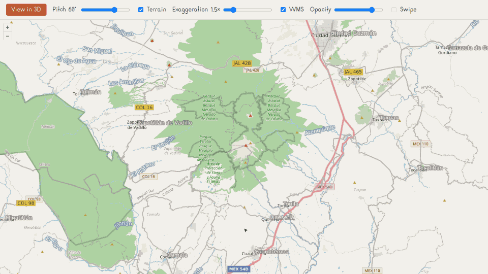

# <picture><source media="(prefers-color-scheme: dark)" srcset=".github/assets/icon-dark.svg"></picture> alzado

[](https://www.npmjs.com/package/alzado)
[](https://bundlejs.com/?q=alzado)
[](LICENSE)

Headless camera bridge between 2D OpenLayers and 3D MapLibre: pitch, bearing, terrain and a WMS mirror.



alzado owns the camera between the two maps. The OpenLayers view keeps center, zoom and rotation;
alzado adds what OpenLayers lacks — pitch and terrain — and carries the camera both ways, so turning
the map in 3D comes back as rotation in 2D. It also mirrors your OpenLayers WMS layers into MapLibre as
raster tiles, and keeps several MapLibre maps on one camera. You create both maps and own the buttons,
sliders and styles: it ships no UI.

## Install

```bash
npm install alzado ol maplibre-gl
```

| Entry | What it is | Needs |
|---|---|---|
| `alzado` | Framework-free core: camera bridge, terrain, WMS mirror, camera group, pure conversions | `ol >= 10`, `maplibre-gl >= 5` (types only) |
| `alzado/react` | `useAlzado` and `useCameraGroup` | `react >= 19` |

## Quick start

```ts
import { Map as MapLibreMap } from 'maplibre-gl';
import OlMap from 'ol/Map.js';
import View from 'ol/View.js';
import { createAlzado, mirrorWmsLayers } from 'alzado';

const olMap = new OlMap({ target: 'map-2d', view: new View({ center: [0, 0], zoom: 3 }) });
const map = new MapLibreMap({ container: 'map-3d', style: 'https://demotiles.maplibre.org/style.json', maxPitch: 85 });

const alzado = createAlzado({
    view: olMap.getView(),
    map,
    pitch: 60,
    terrain: { source: { tiles: ['https://dem.example/{z}/{x}/{y}.png'], encoding: 'terrarium', maxzoom: 15 }, exaggeration: 1.5 },
});
mirrorWmsLayers({ olMap, map });
alzado.enter();
```

`enter()` moves the MapLibre camera to the OpenLayers view with the requested pitch; `exit()` writes
center, zoom and bearing back to the view. Showing one map or the other is up to you.

## Camera

| Feature | API |
|---|---|
| Camera both ways: center, zoom, bearing ⇄ rotation, pitch | `createAlzado`, `enter`, `exit`, `setPitch` |
| Sync on every move (`live`, default) or only when switching (`onSwitch`) | `mode` |
| Requested pitch survives when MapLibre lowers it to stay above the terrain | `getSnapshot().pitch` |
| Map created later, or replaced | `map` option, `setMap(map \| null)` |
| Current camera, from MapLibre if attached or from the view | `getCamera()` |
| State for any UI: `active`, `pitch`, `terrain` | `subscribe`, `getSnapshot` |

- MapLibre zoom is OpenLayers zoom minus one in Web Mercator (`zoomOffset`, default `1`).
- In `live` mode the view follows every MapLibre `move` and MapLibre follows every view change while
  active; a guard by origin stops the echo. In `onSwitch` mode the camera travels only on `enter` and
  `exit`.
- A user gesture (an event with `originalEvent`) replaces the requested pitch; for programmatic
  changes call `setPitch`.
- The bearing comes back as the rotation closest to the current one, so the view does not spin.

## Terrain

```ts
const alzado = createAlzado({
    view,
    terrain: { source: { tiles: ['https://dem.example/{z}/{x}/{y}.png'], encoding: 'custom', redFactor: 256, greenFactor: 1 } },
});

alzado.setTerrain({ exaggeration: 2 });
alzado.setTerrain({ enabled: false });
```

| Option | Default | What it does |
|---|---|---|
| `source` | — | Tiles (`mapbox`, `terrarium` or `custom` encoding), a full `raster-dem` spec, or the id of a source already in the style |
| `sourceId` | `'alzado-terrain'` | Id of the source alzado adds |
| `exaggeration` | `1` | Vertical exaggeration |
| `enabled` | `true` | Start with the terrain on |

`demSource(tiles)` builds the `raster-dem` spec (tile size 256) if you want to add it yourself. The
terrain is re-added after `map.setStyle()`.

## WMS mirror

`mirrorWmsLayers({ olMap, map })` copies the visible `TileWMS` and `ImageWMS` layers of the OpenLayers
map into MapLibre as raster sources, by `zIndex` order, effective opacity (groups included), visibility
and zoom range (`minZoom`/`maxZoom` and `minResolution`/`maxResolution`). It follows changes in the
layer group and re-adds the layers after `map.setStyle()`.

| Option | Default | What it does |
|---|---|---|
| `filter` | every WMS layer | `(layer) => boolean`, which layers to mirror |
| `params` | — | `(layer) => params`, extra or replaced WMS parameters |
| `beforeId` | on top | MapLibre layer to insert the mirrored layers before |
| `prefix` | `'alzado-wms-'` | Prefix of the source and layer ids |
| `tileSize` | `256` | Tile size requested from the server |
| `baseUrl` | `location.href` | Base for relative WMS URLs |
| `zoomOffset` | `1` | Same offset as the camera |

It returns `sync()`, `ids()` and `destroy()`. `wmsTileUrl(url, params)` builds the
`{bbox-epsg-3857}` template on its own: it drops the parameters MapLibre sets (`WIDTH`, `BBOX`, `SRS`…)
and uses `CRS` for WMS 1.3.0, the default version.

## Camera group

```ts
import { createCameraGroup } from 'alzado';

const group = createCameraGroup();
const remove = group.add(mainMap);
group.add(swipeMap);
```

One camera across several MapLibre maps, for swipe or split view. A new member jumps to the camera of
the first one; any member that moves drives the rest. `remove`, `members` and `destroy` complete it.

## Conversions

`viewToCamera`, `cameraToView`, `applyCamera`, `readCamera`, `sameCamera`, `rotationToBearing`,
`bearingToRotation` and `wrapDegrees` are pure functions, if you prefer to drive the cameras yourself.

## React

```tsx
import { useAlzado, useCameraGroup } from 'alzado/react';

const { active, pitch, terrain, toggle, setPitch, setTerrain } = useAlzado(alzado);
useCameraGroup(map, group);
```

`useAlzado` returns the snapshot plus `enter`, `exit`, `toggle`, `setPitch` and `setTerrain`.
`useCameraGroup` adds the map to the group while it is not `null` and removes it on unmount.

## Known limitations

- OpenLayers snaps rotations under 5° to zero by default; pass `constrainRotation: false` to the
  view if small bearings must come back.
- The zoom offset assumes Web Mercator, and mirrored WMS layers are requested in `EPSG:3857`.
- Only WMS is mirrored; WMTS and XYZ layers are not yet.
- Sky and fog are left to you (`map.setSky`).
- alzado imports only types from `maplibre-gl`: you create and load the map.

## Development

```bash
npm test
npm run lint
npm run typecheck
npm run build
npm run demo
npm run e2e
```

The demo shows OpenLayers with OSM and a public WMS, and MapLibre with Terrarium terrain and hillshade:
switch views, pitch, terrain and exaggeration, WMS visibility and opacity, and a swipe map on a shared
camera. The e2e runs Playwright against the demo with the external tiles blocked.

## Contributing

Issues are welcome. Open one before sending a pull request.

## License

AGPL-3.0-only © GHEgar
